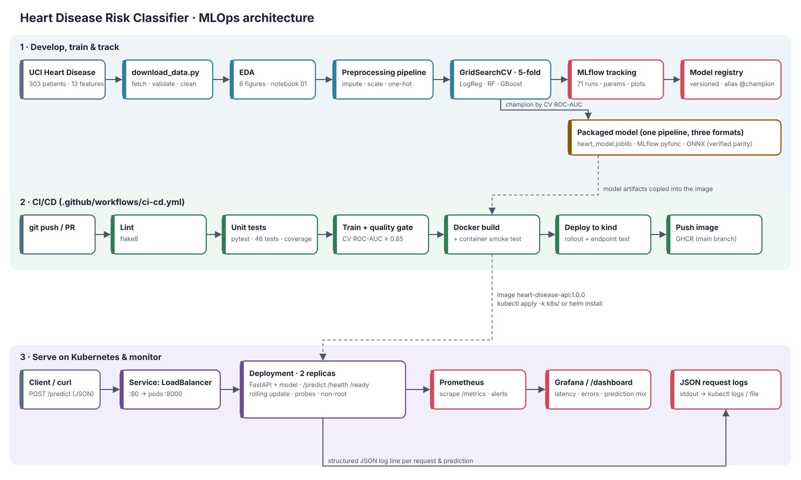

# Heart Disease Risk Classifier — End-to-End MLOps

Predicts the presence of heart disease from 13 clinical attributes (UCI Heart Disease,
Cleveland subset) and serves the model as a monitored, containerised API on Kubernetes.

| Stage | What is in this repo |
|---|---|
| Data | `scripts/download_data.py` (UCI source + mirror fallback), cleaned CSV in `data/processed/` |
| EDA | `notebooks/01_eda.ipynb`, figures in `reports/figures/` |
| Models | Logistic Regression, Random Forest, Gradient Boosting · GridSearchCV · 5-fold CV |
| Tracking | MLflow: 3 model runs + 68 nested grid-candidate runs, plots, model registry alias `@champion` |
| Packaging | One sklearn `Pipeline` (preprocessing + model) saved as joblib, MLflow model and ONNX |
| Tests / CI | 46 pytest tests · flake8 · GitHub Actions: lint → test → train → Docker → deploy to kind |
| Serving | FastAPI `/predict` (prediction + confidence), Docker image, K8s manifests + Helm chart |
| Monitoring | JSON request logs, Prometheus metrics + alert rules, Grafana dashboard, built-in `/dashboard` |

**Champion model:** logistic regression (C = 0.3, L2, balanced class weights)

| | ROC-AUC | Accuracy | Precision | Recall | F1 |
|---|---|---|---|---|---|
| 5-fold CV (train split, mean) | 0.907 | 0.855 | 0.882 | 0.801 | 0.834 |
| Held-out test (61 patients) | 0.961 | 0.869 | 0.813 | 0.929 | 0.867 |



---

## 1. Setup (clean environment)

Python 3.11 (CI) or 3.12. Docker for the container steps; kubectl + a local cluster
(Docker Desktop Kubernetes or Minikube) for deployment.

```bash
git clone <your-repo-url> heart-disease-mlops && cd heart-disease-mlops
python -m venv .venv && source .venv\Scripts\activate      # Windows: .venv\Scripts\activate
pip install -r requirements.txt
pip install -e .
```

Conda alternative: `conda env create -f environment.yml && conda activate heart-mlops && pip install -e .`

## 2. Run the pipeline

```bash
python scripts/download_data.py      # data/raw + data/processed/heart_clean.csv
python -m heart.eda                  # EDA figures -> reports/figures/
python -m heart.train                # tune + train + MLflow + package -> models/
python scripts/export_mlflow_runs.py # runs -> reports/mlflow_runs.csv
mlflow ui --backend-store-uri sqlite:///mlflow.db --port 5000   # http://localhost:5000
python -m pytest -v                  # unit tests
flake8                               # lint
jupyter nbconvert --to notebook --execute --inplace notebooks/*.ipynb
```

`make help` lists the same steps as Make targets. `scripts/run_ci_locally.sh` runs the
CI stages (lint, test, train, quality gate, docker build, smoke test) on your machine and
stops at the first failure.

Inference from the command line:

```bash
python -m heart.predict --json "$(cat samples/patient_high_risk.json)"
python -c "import json,runpy,sys; sys.argv=['heart.predict','--json',json.dumps(json.load(open('samples/patient_high_risk.json', encoding='utf-8')))]; runpy.run_module('heart.predict', run_name='__main__')" ## WIndows
```

## 3. API

```bash
uvicorn app.main:app --port 8000          # or the Docker image below
curl -X POST http://localhost:8000/predict \
     -H 'content-type: application/json' -d @samples/patient.json
# {"prediction":0,"label":"no heart disease","probability_disease":0.3526,"confidence":0.6474,"model_version":"1"}
```

| Endpoint | Purpose |
|---|---|
| `POST /predict` | one patient (JSON, 13 fields; `ca`/`thal` may be null) → prediction, label, probability, confidence |
| `POST /predict/batch` | `{"instances": [...]}` up to 1000 patients |
| `GET /health`, `GET /ready` | liveness / readiness (503 until the model is loaded) |
| `GET /model` | model version, metrics, MLflow run id, git commit |
| `GET /metrics` | Prometheus metrics |
| `GET /dashboard` | built-in live monitoring page (reads `/stats`) |
| `GET /docs` | Swagger UI |

Invalid input (out-of-range values, unknown codes, missing or extra fields) returns HTTP 422.

## 4. Docker

```bash
docker build -t heart-disease-api:1.0.0 .
docker run -d -p 8000:8000 --name heart-api heart-disease-api:1.0.0
scripts/smoke_test.sh http://localhost:8000
docker compose up -d --build     # API + Prometheus (:9090) + Grafana (:3000, admin/admin)
```

The image is multi-stage, runs as a non-root user, has a `HEALTHCHECK`, and only contains
serving dependencies (`requirements-serve.txt`).

## 5. Kubernetes

**Docker Desktop** (Settings → Kubernetes → Enable):

```bash
docker build -t heart-disease-api:1.0.0 .
kubectl apply -k k8s/
kubectl -n heart-mlops rollout status deploy/heart-api
kubectl -n heart-mlops get pods,svc        # EXTERNAL-IP = localhost
scripts/smoke_test.sh http://localhost
```

**Minikube:**

```bash
minikube start
eval $(minikube docker-env) && docker build -t heart-disease-api:1.0.0 .
kubectl apply -k k8s/
minikube tunnel            # separate terminal; gives the LoadBalancer an IP
kubectl -n heart-mlops get svc heart-api   # use EXTERNAL-IP
# Ingress instead: minikube addons enable ingress, add "<minikube ip> heart-api.local" to /etc/hosts
```

**Helm** (alternative to the raw manifests): `helm upgrade --install heart-api helm/heart-api -n heart-mlops --create-namespace`

**Cloud (GKE/EKS/AKS):** push the image to a registry (the CI workflow pushes to
`ghcr.io/<owner>/heart-disease-api` on `main`), set `image:` in `k8s/02-deployment.yaml`
(or `--set image.repository=...` with Helm) and apply; the LoadBalancer Service gets a public IP.

In-cluster monitoring: `kubectl apply -f k8s/monitoring/` then
`kubectl -n heart-mlops port-forward svc/prometheus 9090` and `svc/grafana 3000`.

## 6. CI/CD

`.github/workflows/ci-cd.yml` runs on every push / PR:

1. **lint** – flake8 (errors annotated on the PR)
2. **test** – pytest + coverage; JUnit and HTML coverage uploaded as artifacts
3. **train** – download data, EDA, GridSearchCV + MLflow; fails if CV ROC-AUC < 0.85;
   uploads `models/`, `reports/`, the MLflow store and the training log
4. **docker** – build image, run it, `scripts/smoke_test.sh`; uploads image + container logs;
   pushes to GHCR on `main`
5. **deploy-k8s** – creates a kind cluster, `helm lint`, applies the manifests, waits for the
   rollout and smoke-tests through the Service

Every step runs under `bash -euo pipefail`, so a lint error, failing test, quality-gate miss
or failed HTTP check fails the job and blocks the jobs after it.

## 7. Monitoring and logging

* Each request is logged as one JSON line (request id, path, status, latency); each
  prediction is logged with its inputs and output. Set `LOG_FILE` to also write a rotating file.
* Prometheus metrics: `api_requests_total`, `api_request_latency_seconds`,
  `model_predictions_total{label}`, `model_prediction_probability`, `model_loaded`, `model_info`.
* `monitoring/alerts.yml`: API down, error rate > 5 %, p95 latency > 500 ms, model not
  loaded, and a prediction-mix drift signal.
* Grafana dashboard: `monitoring/grafana/dashboards/heart-api.json` (auto-provisioned by
  docker compose).

## 8. Repository layout

```
app/                 FastAPI service (main.py, schemas.py, dashboard.html)
src/heart/           config, data, features, eda, train, evaluation, predict
scripts/             download_data, export_mlflow_runs, smoke_test, load_test, run_ci_locally
notebooks/           01_eda, 02_training, 03_inference (executed, with outputs)
tests/               46 unit/API tests
data/                raw + processed (cleaned) dataset, train/test split
models/              heart_model.joblib, model_metadata.json, heart_model.onnx, mlflow_model/
reports/             figures, model_comparison.csv, mlflow_runs.csv, metrics.json, final report
k8s/                 namespace, configmap, deployment, LoadBalancer service, ingress, HPA, monitoring/
helm/heart-api/      Helm chart
monitoring/          Prometheus config + alert rules, Grafana provisioning + dashboard
screenshots/         evidence for the report (MLflow, API, Kubernetes, Prometheus, CI)
docs/                architecture diagram
video/               pipeline walkthrough video
```

## 9. Report, screenshots and video

* Report: `reports/MLOps_Heart_Disease_Report.docx` (and `.pdf`)
* Screenshots: `screenshots/` (see `screenshots/README.md` for what each shows)
* Video: `video/pipeline_walkthrough.mp4`

## 10. Data source

UCI Machine Learning Repository, Heart Disease dataset (Janosi, Steinbrunn, Pfisterer,
Detrano, 1988), `processed.cleveland.data`. The download script records which URL was used
and the file's SHA-256 in `data/raw/SOURCE.txt`. Target: `num > 0` → 1 (disease).
